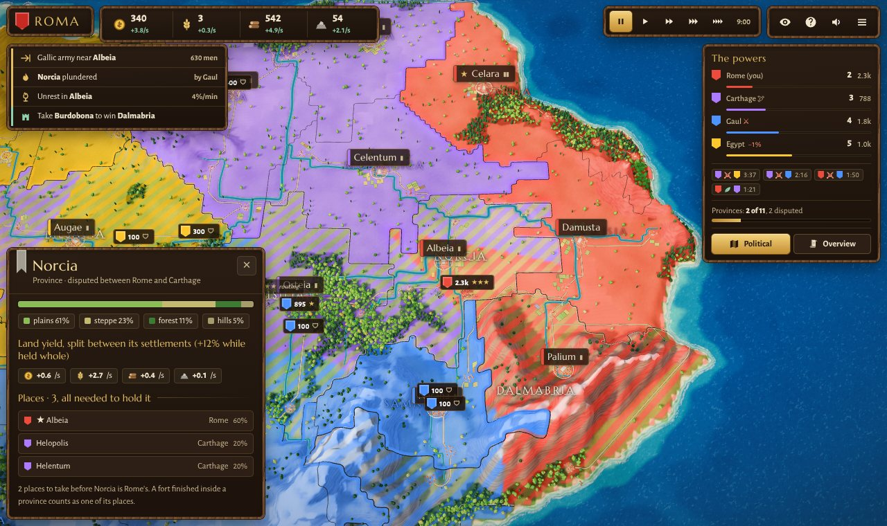
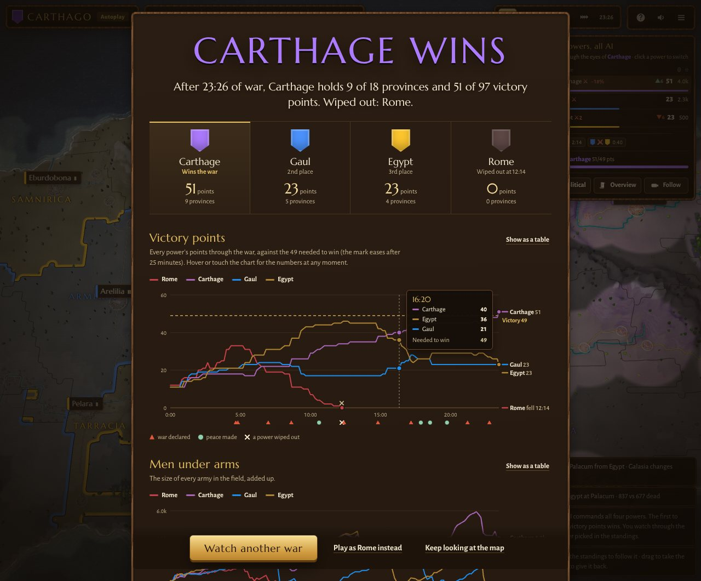

# Testudo Imperium

Turn-based strategy in the browser. Play Rome, Carthage, the Gauls or Egypt on a procedurally generated continent: raise armies, wall your cities, plunder enemy provinces, and make peace when the war turns against you. Win by holding 60% of the provinces, each one whole.



- **Simultaneous turns**: the world waits while you give your orders, and your rivals make theirs from what they can see. End the turn and every power moves at once, battles and all, for a season; then the world stops again with a report of what happened. A selected army's route shows where it will stand at the end of each turn. A war lasts about 40 to 60 turns.
- **Four powers, each with its own elite unit and speciality**: Roman legionaries and engineering, Punic war elephants, mercenaries and harbours, Gallic gaesatae and tribal levies, Egyptian chariots and the gift of the Nile.
- **Provinces are won whole**: a province is yours only while you hold its major city, every town and every fort built in it. Split between holders it is disputed, hatched on the map and counting for nobody. Forts are one more place to hold, and a way to keep a rival from completing a province.
- **Terrain matters on the march**: armies go twice as fast on roads, slowly through forests and very slowly over mountains, and wide rivers can only be crossed on a bridge (narrow streams can be waded).
- **Fog of war, for everyone**: each power, the AI included, only sees the land around its cities, armies and forts; cavalry and high ground see further. The AI judges unseen cities by its last report.
- **Battles decided by strategy**: terrain, rivers, walls, flanks, stance and the odds you accept. Retreat when a battle turns, or let the army fall back by itself when it is plainly lost; an aggressive army presses on to the next place of the province it is taking.
- **An economy of land and cities**: provinces share their land income between settlements, cities take improvements (farmlands, forum, barracks, temple), soldiers draw pay, and conquered cities can revolt.
- **War and peace**: powers stay at peace until one declares war. Wars wear both sides down until they sign a treaty, with tribute paid by the loser.
- **Know what's going on**: dispatches flag what needs attention now (cities under assault, enemy armies closing in, plunder, famine, unrest, a rival nearing victory), the Overview shows your treasury, armies, cities and wars, and the chronicle records the whole war. When it ends, a report charts how it went, economy included.
- **Made for phones too**: one slim strip of treasury on top, the commands in a dock under the thumb (next army, the turn and its speed, End turn, Overview, political map, hide the panels), and orders in two taps: the first plants a standard showing the route, how many turns the march takes and the odds, the second gives the order, so a stray tap never sends an army off. Hold an army to add it to the selection. Held sideways, the panel opens beside the map.
- **Autoplay** to watch four AI empires fight it out through the eyes of the power you follow, and take command of it at any moment. Three difficulty levels, and saves that survive closing the tab.



Everything is procedural and drawn in code: the map, the painted terrain, the trees, cities, soldiers and the synthesized sound.

## Run it locally

You need [Node.js](https://nodejs.org) 20.19 or newer.

```sh
npm install
npm run dev
```

Then open the address Vite prints (usually http://localhost:5173). Edits to the code reload the page.

| Command | What it does |
|---|---|
| `npm run dev` | Development server with live reload |
| `npm run build` | Production build into `dist/` |
| `npm run preview` | Serve the production build locally |
| `npm run lint` | Check the code for mistakes (undefined or unused names) |
| `npm test` | Lint, build, then run the test suite in headless Chromium |
| `npm run balance -- 40` | Play 40 AI-vs-AI wars and report win rates, war length and economy |
| `npm run audit -- 12` | Count how often every mechanic is used across 12 AI wars |
| `npm run citylab` | The city lab: every culture's towns, cities and capitals side by side, with improvements and walls to switch on and off |

The browser tests need Chromium once: `npx playwright install chromium`.

## Project layout

```
index.html            page markup: HUD, panels, title and help screens
citylab.html, lab/    the city lab (a page of its own, built with the game)
src/
  main.js             boot and the frame loop
  three.js            three.js, set up once (colour management)
  debug.js            test hook, loaded only with ?test
  styles/main.css     all the UI styling (colour tokens at the top)
  assets/fonts/       Marcellus and Alegreya Sans
  assets/units/       close-up unit models (.glb), made by tools/blender
  assets/landmarks/   the cities' landmark models (.glb), made by tools/blender
  core/               helpers, synthesized audio
  map/generate.js     the continent: relief, biomes, rivers, provinces, cities, roads,
                      bridges, fords and the marching cost of every cell (pure JS)
  render/             everything drawn in 3D: terrain, water, vegetation, cities,
                      soldiers (instanced crowds), overlays, camera, light and clouds
  render/citygen.js   the city generator; render/city/ holds each culture's rules
  game/               the simulation: factions and units (data.js), armies and pathfinding,
                      battles, economy, standing and victory, diplomacy, AI, fog of war
                      (sight.js), the record of the war (chronicle.js), save & resume
  ui/                 panels, HUD, dispatches (alerts.js), the Overview (overview.js),
                      the end-of-war report (report.js), map labels, input, screens,
                      the autoplay camera
tests/                Node and browser tests (npm test)
tools/                balance and audit scripts; tools/blender: the soldiers' and landmarks' Blender models
```

The simulation in `src/game` advances in fixed steps (`simStep`) and doesn't depend on rendering, which is what lets the tests and tools play whole wars in seconds with the renderer switched off. A turn (`game/turns.js`) is 30 seconds of that game time: at its start every AI power gives its armies their orders (`aiPlan`), while the screen (`ui/turnflow.js`) waits for the player's; then the turn plays out in steps, at the speed the player picks, and stops at its end. Played straight through, as the tools do, a war plans at the same moments.

Saves live in the browser's `localStorage` under `testudo.save.v1`. Only the changing state is stored; the map is rebuilt from its seed. If you change the save format, keep `restoreGame` able to read older saves (it already upgrades saves from before the war and peace system).

## Tests

`npm test` builds the game and runs:

- **map**: map generation is deterministic and every province has its cities (plain Node).
- **params**: every balance number has a meaning and bounds, `balance.js` writes back exactly, a value changed at run time reaches the game and its texts, and the battle lab is deterministic.
- **turns**: in plain Node, the AI orders its armies at the start of each turn and never in between, a lost battle is broken off without waiting for an order, an aggressive army that takes a place presses on to the next one of its province, and envoys wait for the player's next orders.
- **cities**: the city generator in plain Node: the same city always comes out the same, every culture fills its towns inside the walls, each improvement raises its landmark and only takes the ground of the houses it replaces, the far version is lighter, and every style of wall stands.
- **smoke**: a campaign plays on desktop and phone sizes, every panel (Overview tabs included) renders, the fog hides what it should, the war is recorded and the end-of-war report renders, cities switch between their two versions and show the improvements they built, the city lab loads, no console errors.
- **controls**: on a phone, the dock steps through the armies; a tap plans a march and a second tap gives it; a tap on an enemy town shows the odds; a long press adds an army to the selection; End turn plays a turn, which can be paused, sped up and skipped, while orders wait; the layout held upright and sideways. On a desktop, the keys that step through the armies, and Enter plays a turn out to its end, where the world stops with the turn's report.
- **powers**: another power (Carthage) can be played and resumed, autoplay is seen through the followed power's eyes, and you can take command of it.
- **determinism**: the same seed gives exactly the same game, whatever sounds and effects do with their own random numbers, and a war saved and loaded goes on exactly as if it had never stopped.
- **headless**: the simulation runs in plain Node, without a browser, and ten minutes of war there match the browser's exactly, byte for byte (the tuning tools play their wars this way).
- **save & resume**: play, close the tab, reopen, and check the restored game matches the save exactly.

GitHub Actions runs the same suite on every push and pull request (`.github/workflows/ci.yml`).

For balance work, `npm run balance` and `npm run audit` play AI wars and print the numbers that matter: win rates per power (aim for 20–30% each), war length, elite share of recruits, how many wars run at once, and how often walls, forts, markets, improvements, retreats, revolts and peace treaties are used.

## Tuning the balance

Every number the balance rests on (250 of them: units, elite units, combat rules, buildings, perks, economy, the AI's tastes, diplomacy) lives in `src/game/balance.js`, and `src/game/params.js` says what each one means and how far it may move. Three labs measure them, and a tuner looks for better values.

| Command | What it does |
|---|---|
| `npm run params -- list perks` | Every parameter of a group (or matching a word) with its value and bounds. `set id=value` writes `balance.js`, `diff` compares with git, `check` checks the bounds |
| `npm run lab` | The battle and economy labs and their scorecard, in a few seconds |
| `npm run lab -- wars 200` | The same, plus 200 AI wars on every core (always the same seeds, so two runs compare fairly) |
| `npm run tune` | Tune, then check the result on wars the tuner never played; a report in `tools/out/tune-<date>/` |
| `npm run tune -- fast` / `fair` | Only one of the two steps; `--apply` writes `balance.js` when the result does better |

- **Battle lab**: isolated battles fought by the game's own combat code, without dice, between armies of equal worth (their price plus three minutes of upkeep). It checks the counters the game promises (spears stop horse, horse rides down archers, elephants trample legions…), that no unit is the best buy everywhere, and how each power's usual army fares against the others'. Exact, and fast enough to try hundreds of variants a minute.
- **Economy lab**: what improvements, walls and siege engines give back for their price, straight from the rules.
- **War lab**: AI-vs-AI wars in plain Node, on every core, with every mechanic counted: win shares with their 95% intervals, war length, the units raised, improvements, forts, retreats, revolts, peace treaties, and what each power's perk is worth per minute.
- **The tuner** first works on the units, elites, combat and buildings with the two fast labs. It moves a few values at a time, prefers small changes, and puts back any change the result doesn't need. Then it evens out the powers' wins over rounds of wars, moving one perk per power (perks don't count in the battle lab's equal-worth fights, so this leaves the units alone). Last, it plays wars it never saw, before and after, and only applies the result if it does better.
- **The targets** (what "well balanced" means, and which perk is each power's lever) are in `tools/lab/targets.js`. Change them to change the goal.
- **On GitHub**: the *Tune the balance* workflow (Actions tab, Run workflow) does the same with more wars: the tuning on one machine, the check spread over parallel jobs. *Propose* leaves a report in the run's summary and artifacts; *apply* runs the tests on the new values and opens a pull request. Opening it needs Settings › Actions › General › "Allow GitHub Actions to create and approve pull requests".

The labs see what the AI does, not what a human would: a mechanic the AI rarely uses (forts) looks weak, and the AI recruits by a fixed taste per power rather than by price. The battle lab's measures don't depend on the AI's choices, which is why the tuner leans on it first.

## Deploy on Vercel

1. On [vercel.com](https://vercel.com), choose **Add New → Project** and import this GitHub repository.
2. Vercel detects Vite. Keep the defaults: build command `npm run build`, output directory `dist`.
3. Deploy. From then on, every push to `main` updates the live site, and every pull request gets its own preview link.

The game is a static site, so any static host works too (Netlify, Cloudflare Pages, GitHub Pages). Vercel's free Hobby plan is meant for personal, non-commercial projects.

## Improving the visuals

- **Interface**: `src/styles/main.css` and the markup in `index.html`. Colours are CSS variables at the top of the stylesheet.
- **3D world**: each part has its own module in `src/render/`. Soldiers are in `crowds.js` (instanced, so hundreds stay cheap), cities and walls in `cities.js`, the painted ground in `terrain.js`, light, shadows and clouds in `atmosphere.js`.
- **Unit models (close up)**: armies near the camera are drawn with detailed models, the rest with the light procedural soldiers of `crowds.js`. The models are built in code from a base soldier with a skeleton (`tools/blender/soldier_base.py`), posed and dressed per unit (`tools/blender/units.py`), and exported to `src/assets/units/<unit>.glb`: `python3 tools/blender/units.py spear` with the `bpy` module (`pip install bpy`), or *Run Script* in Blender. `src/render/models.js` lists the files (`MODEL_URLS`) and loads them in the background; a unit without a file keeps its light model up close. A model from elsewhere works too if it follows the same rules: Blender metres (the game scales by 0.2), feet at 0, facing Blender's front (-Y), plain colours per material with `tint` for the power's colour, and the vertex attributes `_part` (1 and 2 the legs, 3 the weapon arm, 4 a siege engine's throwing arm) and `_wave` (cloth). Keep a close-up model under about a thousand triangles: up to `NEAR_CAP` of them are drawn at once.
- **Cities**: `src/render/citygen.js` lays a city out the way procedural city tools do, at the scale of a town: streets from the gates the map's roads arrive at, then blocks and plots, then a building on each plot from its culture's rules, then the landmarks of the improvements it has built. Each culture is a module in `src/render/city/` (`roman.js`, `punic.js`, `gaul.js`, `egypt.js`, with what they share in `kit.js`): its planner (a grid for Rome, Carthage and Egypt, paths and darts thrown for a Gaulish oppidum), its buildings, its palette and its walls. A province builds in one style: a power's starting provinces in its own, every other province in the style of the nearest starting province over land; a city keeps its style when it changes hands. Everything comes from the city's seed, and each block (or a Gaulish town's houses) from a seed of its own, so a new forum only replaces the houses on its ground. Houses keep off the rivers that run through a city, and its main streets and gate roads cross them on bridges. Seen from afar (`CITY_NEAR_IN` in `cities.js`), a city is drawn without its small things (doors, windows, jars, posts); the full version is built the first time the camera comes close. Try changes in the city lab (`npm run citylab`), which builds every culture at every size with the game's own code.
- **Landmark models**: the Roman temple and amphitheatre, the Egyptian pylon and lighthouse, the Punic temple and the Gaulish chief's hall are modelled in Blender by `tools/blender/landmarks.py` (`python3 tools/blender/landmarks.py` with the `bpy` module, or *Run Script* in Blender) and exported to `src/assets/landmarks/<key>.glb`. `src/render/landmarkModels.js` loads them in the background and the cities are rebuilt once they arrive; the builders place them with `model()` (`render/city/kit.js`), scaled to the ground they are given, and draw their procedural landmark when a file is missing. A model of your own works if it is one mesh in plain colours, standing on 0, its front toward Blender's -Y.
- **three.js** is pinned to 0.149.0. Upgrading past r152 changes colour management and r155 changes light intensities, so plan a visual pass when you upgrade.

## Known issues

- The AI almost never attacks from two sides, so flanking is mostly a player tactic.

## Credits and licence

Fonts: Marcellus and Alegreya Sans, under the SIL Open Font License 1.1.

No licence has been chosen for the code yet, which means all rights are reserved by default. Add a `LICENSE` file if you want others to be able to reuse it.
